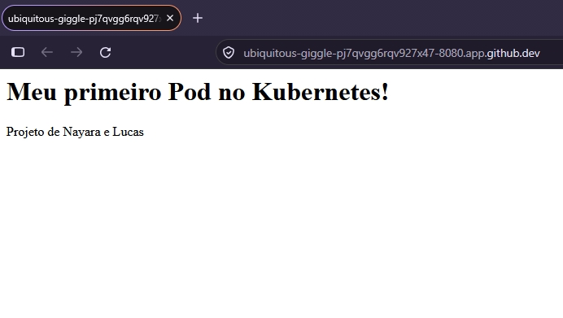

# Arquitetura do Kubernetes

Projeto da Unidade 9: arquitetura visual do Kubernetes (`kubernetes.drawio`), descrição dos componentes e manifestos `pod.yml` e `service.yml` executados no Minikube.

**Integrantes:** Lucas Henrique Dias de Medeiros e Nayara Karla Medeiros da Silva 

## Estrutura do projeto

```
arquitetura_kubernetes/
├── kubernetes.drawio   # desenho da arquitetura
├── README.md           # este arquivo
├── pod.yml             # implementação de um Pod
├── service.yml         # implementação de um Service (NodePort)
└── evidencias/         # prints da execução no Minikube
```

## Visão geral

O Kubernetes (K8s) é uma plataforma de orquestração de containers. Você descreve o **estado desejado** (ex.: "quero 3 réplicas desta imagem") e o Kubernetes trabalha continuamente para que o **estado real** do cluster seja igual a ele.

Um cluster se divide em:

- **Control Plane**: o "cérebro", que toma as decisões.
- **Worker Nodes**: as máquinas que executam os containers.

## Componentes do Control Plane

| Componente | Função |
|---|---|
| **API Server** | Porta de entrada do cluster. Todo comando (kubectl, outros componentes) passa por ele via API REST. Valida e processa as requisições. |
| **etcd** | Banco de dados chave-valor distribuído que guarda todo o estado do cluster (configurações, objetos criados, etc.). |
| **Scheduler** | Observa Pods novos sem Node definido e escolhe o melhor Node para rodá-los, considerando CPU, memória e restrições. |
| **Controller Manager** | Conjunto de controladores que ficam comparando estado desejado × real e corrigindo diferenças (ex.: recriar um Pod que caiu, manter o número de réplicas). |

## Componentes do Worker Node

| Componente | Função |
|---|---|
| **Kubelet** | Agente que roda em cada Node. Recebe as ordens do API Server, garante que os containers dos Pods estejam rodando e reporta o status. |
| **Kube-proxy** | Gerencia as regras de rede no Node, permitindo que o tráfego chegue aos Services e seja encaminhado aos Pods. |
| **Container Runtime** | Software que de fato executa os containers (containerd, CRI-O, Docker). Baixa a imagem do registry (ex.: Docker Hub) e inicia o container. |

## Objetos do Kubernetes

| Objeto | Descrição |
|---|---|
| **Pod** | Menor unidade implantável. Encapsula um ou mais containers que compartilham rede (mesmo IP) e armazenamento. É efêmero: se morrer, o IP muda. |
| **ReplicaSet** | Garante que um número definido de réplicas de um Pod esteja sempre em execução. Se um Pod morre, cria outro. |
| **Deployment** | Gerencia ReplicaSets e permite atualizações graduais (rolling update) e rollback. É a forma mais comum de implantar aplicações. |
| **Service** | Fornece um endereço estável (IP/DNS) e balanceamento de carga para um conjunto de Pods, selecionados por **labels**. Tipos: `ClusterIP`, `NodePort`, `LoadBalancer`. |
| **Labels e Selectors** | Pares chave/valor colados nos objetos. Os selectors usam esses labels para agrupar e encontrar objetos (é assim que o Service acha os Pods). |
| **Namespace** | Divisão lógica do cluster para isolar recursos (ex.: `dev`, `prod`). |
| **ConfigMap / Secret** | Guardam configurações e dados sensíveis (senhas, tokens) separados da imagem do container. |

## Ferramentas

| Ferramenta | Descrição |
|---|---|
| **kubectl** | CLI para interagir com o cluster. Envia comandos ao API Server (`kubectl apply`, `get`, `describe`, `logs`, `delete`). |
| **Minikube** | Cria um cluster Kubernetes local (um único Node) para estudo e desenvolvimento. |
| **Docker Hub** | Registry público onde fica a imagem da aplicação (`usuario/my_app`). |
| **Manifesto YAML** | Arquivo declarativo que descreve o objeto desejado (`pod.yml`, `service.yml`). |

## Fluxo de funcionamento

1. O usuário executa `kubectl apply -f pod.yml`.
2. O **kubectl** envia a requisição ao **API Server**.
3. O API Server valida e grava o estado desejado no **etcd**.
4. O **Scheduler** vê o Pod sem Node e escolhe um Node.
5. O **Kubelet** do Node escolhido recebe a ordem.
6. O **Container Runtime** baixa a imagem do Docker Hub e inicia o container dentro do **Pod**.
7. O **Service** (com ajuda do **kube-proxy**) expõe o Pod para acesso externo.
8. O **Controller Manager** continua vigiando para manter o estado desejado.

## Os manifestos

### pod.yml
Define um Pod chamado `my-app-pod`, com o label `app: my-app`, rodando a imagem própria do Docker Hub na porta do container.

### service.yml
Define um Service `NodePort` que usa o selector `app: my-app` para encontrar o Pod e o expõe na porta `30080` do Node.

## Como executar no Minikube

```bash
# 1. Iniciar o cluster
minikube start

# 2. Criar o Pod e o Service
kubectl apply -f pod.yml
kubectl apply -f service.yml

# 3. Verificar
kubectl get pods
kubectl get services
kubectl describe pod my-app-pod
kubectl logs my-app-pod

# 4. Acessar pelo navegador
minikube service my-app-service
# ou apenas obter a URL:
minikube service my-app-service --url

# 5. Limpar
kubectl delete -f service.yml
kubectl delete -f pod.yml
minikube stop
```

> Dica: se o Pod ficar em `ImagePullBackOff`, confira o nome da imagem e se o repositório no Docker Hub é público.

## Evidências da execução

Adicione os prints na pasta `evidencias/` e referencie aqui:

- `kubectl get pods` com o Pod em `Running`
- `kubectl get services`
- `kubectl describe pod my-app-pod`
- Aplicação acessada pelo navegador via Service




## Contribuições

| Integrante | Contribuição |
|---|---|
| Nayara Medeiros | Desenho no Drawio e pod.yml |
| Lucas Henrique | README, service.yml e execução no Minikube |